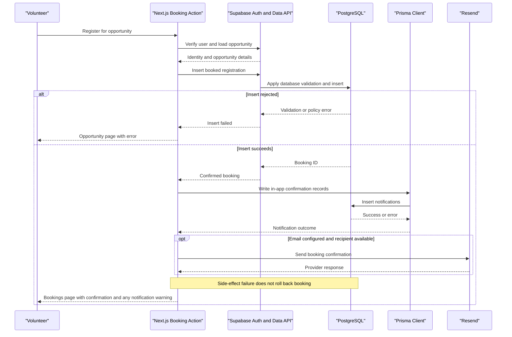
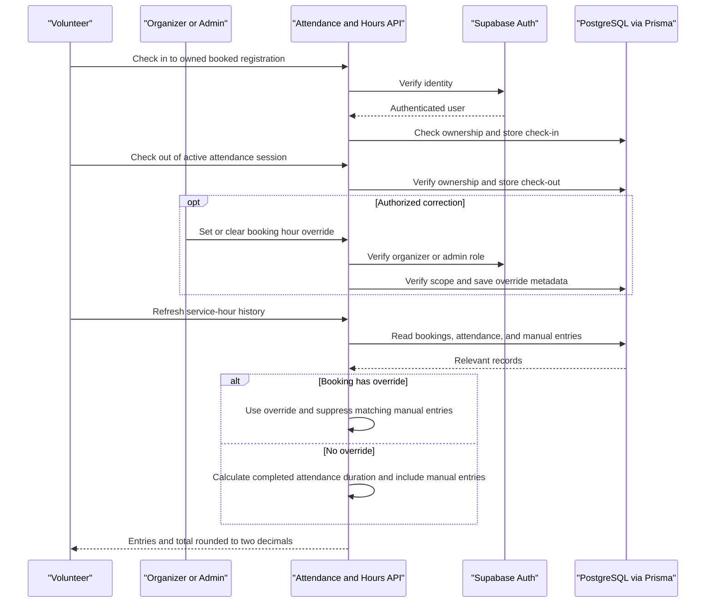

# GIVE: Technical Stack and Process Flow Determination

GIVE connects volunteers with nonprofit opportunities and supports registration, attendance tracking, service-hour reporting, and participant communications. Volunteers, nonprofit organizers, and administrators use separate role-oriented workflows.

## Assessment Basis

- Assessment date: 2026-10-13.
- This is an as-built determination from repository source, dependency declarations, schema, and checked-in SQL migrations, not a proposed redesign.
- Dependency ranges below are declared ranges, not a verification of installed versions.
- Live database policies, triggers, deployment topology, provider credentials, and external service delivery were not verified. No environment-file values were inspected.

## Technical Stack

| Layer | Determined Technology | Role and Evidence |
| --- | --- | --- |
| Web framework | Next.js 16.2.10 | App Router pages, server actions, API route handlers, and request proxy. See [package.json](../../../../../package.json) and [src/proxy.ts](../../../../../src/proxy.ts). |
| UI | React / React DOM 19.2.4 | Server-rendered pages with client components for interactive attendance, notifications, and polling. |
| Language | TypeScript ^5 | Typed application source; shared domain types in [src/lib/types.ts](../../../../../src/lib/types.ts). |
| Styling | Tailwind CSS ^4 and custom CSS | Utility styling plus application-specific rules in [src/app/globals.css](../../../../../src/app/globals.css). |
| Application runtime | Node.js | Next.js development, build, and production commands. An exact runtime version is not pinned by the package manifest. |
| Authentication | Supabase Auth | Email/password registration, sign-in, confirmation, recovery, and cookie-backed sessions. |
| Session integration | @supabase/ssr ^0.12.1 | Server/browser client helpers and proxy session refresh. |
| Supabase data API | @supabase/supabase-js ^2.110.3 | Session-scoped table/view queries and storage operations. |
| Relational persistence | PostgreSQL through Supabase and Prisma | Shared `auth` and `public` schemas; this is not two separate application databases. |
| ORM | Prisma / @prisma/client ^7.9.1 | Generated client and server-side queries, writes, and transactions. See [prisma/schema.prisma](../../../../../prisma/schema.prisma). |
| SQL adapter | @prisma/adapter-pg ^7.9.1, pg ^8.23.0 | Direct PostgreSQL connections via a pooled driver in [src/lib/prisma.ts](../../../../../src/lib/prisma.ts). |
| Object storage | Supabase Storage | Public profile-photo URLs, with authenticated upload/delete operations. |
| Transactional email | Resend | Booking-confirmation HTTP calls and Supabase authentication-email functions. Resend SDK ^6.22.0 and Nodemailer ^9.0.5 are also declared; dependency presence alone does not establish an active SMTP flow. |
| Auth email functions | Supabase Edge Functions / Deno | Signed auth webhook handling and Resend dispatch in [supabase/functions/send-email/index.ts](../../../../../supabase/functions/send-email/index.ts). |
| Mobile-related support | Expo ^57.0.15, expo-notifications / expo-constants ~57.0.13 | Push-token registration helper exists. This does not establish a complete deployed mobile application or end-to-end push delivery. |
| Quality tools | ESLint ^9, eslint-config-next 16.2.10 | `npm run lint`; no test command is declared in the manifest. |

### Architecture Determination

The implemented web application is a modular monolith: one Next.js application owns the UI and application endpoints, with Supabase providing managed identity, database APIs, and storage. Email hooks run separately as Supabase functions. The source does not establish a microservice topology, message broker, durable notification queue, or deployed hosting provider.

Two data-access paths coexist:

1. **Supabase path:** session-backed client -> database API -> PostgreSQL tables/views and applicable row-level security (RLS). Used for opportunity browsing, booking insertion/cancellation, and many page queries.
2. **Prisma path:** server handler/action -> Prisma -> PostgreSQL driver pool. Used for hours, attendance, notification writes, and selected profile lookups. This client does not automatically carry the Supabase user's session or JWT; effective database permissions depend on the connection role. Explicit application authorization is essential.

Supabase authentication and Prisma both refer to the same user identity through the profile ID. Their configuration must point to compatible database/project resources.

## Domain Entities

| Entity | Domain Context | Description | Key Relationships |
| --- | --- | --- | --- |
| Auth user and profile | Identity | Credentials are managed by Supabase; profile stores role, active status, contact details, and preferences. | One profile references an auth user; profile participates as volunteer, owner, sender, or recorder. |
| Organization | Nonprofit management | Nonprofit identity and contact information. | One organization per owning profile in the Prisma schema; many opportunities. |
| Opportunity | Opportunity management | Scheduled service activity with capacity, location, requirements, and publication status. | Owned by an organization; related to bookings, skills, causes, and notifications. |
| Booking | Participation | A volunteer's registration for an opportunity. | Links a volunteer and opportunity; optional attendance log and hour override. |
| Attendance log | Attendance | Attendance classification, check-in/check-out timestamps, and recorder information. | At most one log per booking in the Prisma schema. |
| Manual hour entry | Service reporting | Separately recorded volunteer service time. | References volunteer, opportunity, and recording profile. |
| Notification | Communications | In-app message with recipient, optional sender, and read/archive metadata. | May reference a booking or opportunity. |
| Skill and cause associations | Discovery | Classification supporting opportunity search and user interests. | Links taxonomy records to opportunities and profiles. |

Other schema entities, including messages and audit-related records, are not evidence that every corresponding feature is exposed through an active user workflow.

## Service-to-Domain Mapping

These are logical modules within the same web application, not independent microservices.

| Module | Domain Context | Owned Behavior | External Dependencies |
| --- | --- | --- | --- |
| Auth actions, callback, RoleGate, proxy | Identity | Registration, session establishment, dashboard routing, and page access | Supabase Auth; profile data through Prisma/Supabase |
| Organization and opportunity actions | Nonprofit management | Organization setup, opportunity drafts/publication, edits, and archive | Supabase data API; Prisma notification writes |
| Public opportunity pages and booking actions | Discovery and participation | Filtering, booking creation, and cancellation | Supabase views/tables and database validation; Resend |
| Attendance API routes | Attendance and reporting | Check-in/out, organizer recording, manual hours, and overrides | Supabase identity/role lookup; Prisma persistence |
| Notifications pages and API | Communications | In-app records, inbox retrieval, and message interactions | PostgreSQL through Supabase/Prisma |
| Volunteer profile photo API | Profile management | Image validation, upload, removal, and avatar reference | Supabase Storage; Prisma profile update |
| Admin pages | Administration | Platform summary, user/organization management surfaces, and booking review | Supabase queries; shared attendance APIs |

## Primary Workflows

### Workflow 1: Registration, Authentication, and Role Routing

1. User submits email/password and a volunteer or nonprofit account type. Public registration rejects other roles, including admin.
2. The server checks for an existing non-deleted auth user when the database lookup is available, then calls Supabase signup with profile metadata.
3. The checked-in `handle_new_user` function describes creation of an approved profile. Its deployment and trigger attachment must be verified separately.
4. Where email confirmation is enabled, Supabase initiates confirmation delivery. The custom email function verifies the webhook signature and sends a Resend message if configured as the active hook.
5. The callback exchanges an authorization code for a session; the password-recovery path also supports token-hash OTP verification. It allows only a relative `next` path that does not begin with `//`.
6. Sign-in uses Supabase credentials, looks up the profile role through Prisma with a Supabase fallback on lookup errors, and redirects to the role dashboard.
7. Protected pages use RoleGate to reject missing or inactive profiles and redirect users whose role is not allowed. The proxy delegates session refresh to the Supabase middleware helper.

Password reset is a separate branch: request a recovery email -> callback establishes a recovery session -> reset page submits a matching password of at least six characters. The reset-request success message avoids revealing whether the email exists.

Evidence: [src/lib/actions/auth.ts](../../../../../src/lib/actions/auth.ts), [src/app/(auth)/callback/route.ts](../../../../../src/app/%28auth%29/callback/route.ts), [src/components/RoleGate.tsx](../../../../../src/components/RoleGate.tsx), and [src/lib/role-routing.ts](../../../../../src/lib/role-routing.ts).

### Workflow 2: Organization Setup and Opportunity Publication

1. Nonprofit accesses its dashboard. Without an organization record, the UI directs it to create an organization profile.
2. Opportunity creation requires an active nonprofit, resolves the organization by the authenticated user's ID, and requires the core opportunity fields and positive capacity.
3. Submission selects draft or published status and includes selected skill/cause associations.
4. Publishing makes the opportunity eligible for the public listing view, subject to the view definition and RLS.
5. Publication notification logic creates in-app records for active volunteer profiles. Notification failure is a separately handled side effect, not proof that publication was rolled back.
6. Organizers can edit schedules and archive only their organization's opportunities. Mutations must return an affected row before success or notification side effects; schedule notifications use persisted values. The bookings page recognizes unread, unarchived `schedule_updated` notifications and highlights affected opportunities.
7. The nonprofit dashboard retrieves signup counts through a non-cached API, scoped to the owner's non-deleted opportunities; counts exclude cancelled bookings.

**Approval determination:** the checked-in removal migration makes approval automatic and removes approval checks from public listing/booking rules. Approval fields and older admin UI wording remain, so they must not be interpreted as an active mandatory approval stage.

Evidence: [src/lib/actions/opportunities.ts](../../../../../src/lib/actions/opportunities.ts), [src/app/nonprofit/dashboard/page.tsx](../../../../../src/app/nonprofit/dashboard/page.tsx), [src/app/api/nonprofit/signup-counts/route.ts](../../../../../src/app/api/nonprofit/signup-counts/route.ts), and [supabase/migrations/20260929000000_remove_admin_approval.sql](../../../../../supabase/migrations/20260929000000_remove_admin_approval.sql).

### Workflow 3: Discovery, Booking, and Cancellation

1. Visitor browses the public opportunity listing, with keyword, city, date, skill, and cause filters. Invalid dates or unmatched taxonomy selections produce no matching results.
2. Booking submission requires an active volunteer and a published, nondeleted opportunity record.
3. The server derives the volunteer identity from the session and inserts a `booked` record through Supabase. Database policies, field-protection triggers, capacity locking, and the partial unique index independently enforce direct-client writes after the tenant-authorization migration is deployed.
4. Once insertion succeeds, the action creates a volunteer confirmation notification and, when applicable, an organization-owner notification through Prisma.
5. It attempts booking-confirmation email through Resend. Missing configuration skips email; provider errors are logged. Neither reverses the booking.
6. The user is redirected to bookings. A notification-write failure can be shown alongside successful booking confirmation.
7. Cancellation updates status and cancellation time through Supabase, filtering by booking ID, current volunteer ID, and booked/waitlisted status. A zero-row mutation is rejected. Database policies and triggers prohibit changing reservation relationships or organizer-controlled fields.

There is no booking RPC invocation in this action. The transactional-bookings migration was deployed and verified in remote migration history. The subsequent tenant-authorization migration and application checks have PostgreSQL RLS and handler regression tests; its remote deployment is a separate step.

Evidence: [src/app/(public)/opportunities/page.tsx](../../../../../src/app/%28public%29/opportunities/page.tsx), [src/lib/actions/bookings.ts](../../../../../src/lib/actions/bookings.ts), and [src/lib/email.ts](../../../../../src/lib/email.ts).

### Workflow 4: Attendance and Service-Hour Determination

1. Volunteer checks in to an owned booking whose status is `booked`. The API rejects duplicate check-in and stores a server timestamp with attendance status `present`.
2. Volunteer checkout requires an owned attendance log with a check-in and no prior checkout, then stores a server checkout timestamp.
3. Nonprofit organizers and admins can record attendance classifications. Organizers are limited to their own opportunities; admins can operate across organizations.
4. Manual hour recording requires an eligible participant and organizer/admin authorization. It rejects entries when that booking already has both attendance timestamps.
5. Authorized organizers/admins can set a booking-level override or clear it by submitting `null`; recorder, time, and notes accompany the override.
6. Hours retrieval merges non-cancelled bookings and manual hour records, calculates totals, and sorts entries by recording time. Admins may request another user's hours; non-admin opportunity-wide queries require organization ownership.
7. The volunteer dashboard polls every three seconds, refreshes when visible, and uses BroadcastChannel messages to refresh cooperating same-origin browser contexts. This is not cross-device push or guaranteed real-time delivery.

The attendance endpoints update attendance logs, not automatically the booking status to `completed`.

Evidence: [src/app/api/attendance/check-in/route.ts](../../../../../src/app/api/attendance/check-in/route.ts), [src/app/api/attendance/check-out/route.ts](../../../../../src/app/api/attendance/check-out/route.ts), [src/app/api/attendance/record/route.ts](../../../../../src/app/api/attendance/record/route.ts), [src/app/api/attendance/hours/record/route.ts](../../../../../src/app/api/attendance/hours/record/route.ts), [src/app/api/attendance/hours/override/route.ts](../../../../../src/app/api/attendance/hours/override/route.ts), and [src/components/VolunteerHoursDashboard.tsx](../../../../../src/components/VolunteerHoursDashboard.tsx).

### Workflow 5: In-App Communication and Supporting Operations

- Notifications are persisted application records. A `sent` status is not proof of email delivery or device receipt. The notifications GET API scopes records to the recipient and supports pagination/unread filtering; its query does not exclude archived records or restrict status to `sent`.
- The notifications POST API permits self-addressed messages and allows admins to target other users. This API's restriction should not be generalized to all server actions that create notification records.
- Volunteer profile photos accept validated JPEG, PNG, or WebP content up to 5 MiB. Upload uses the authenticated user's storage path; Prisma then saves the public URL. Storage and profile updates are not one transaction, so partial completion can occur.
- Admin pages summarize platform activity and expose management/review surfaces. Summary data depends on the deployed `admin_platform_summary` view.
- Expo push registration requests native notification permission and saves a token on the profile. End-to-end mobile delivery and its invocation by the web workflows were not established.

Evidence: [src/app/api/notifications/route.ts](../../../../../src/app/api/notifications/route.ts), [src/app/api/volunteer/profile/photo/route.ts](../../../../../src/app/api/volunteer/profile/photo/route.ts), [src/app/admin/dashboard/page.tsx](../../../../../src/app/admin/dashboard/page.tsx), and [src/services/pushNotifications.ts](../../../../../src/services/pushNotifications.ts).

## Cross-Service Data Flows

PostgreSQL is the application record source of truth. Supabase Auth establishes identity; profile data establishes application role and active state. Page queries compose organization, opportunity, booking, and attendance data through database relationships and views. Attendance/hour APIs join these records through Prisma and compute response totals in application code.

Booking persistence, in-app notification writes, and Resend calls are sequential operations across different interfaces, without a shared transaction or documented durable retry mechanism. An email or notification failure must be distinguished from a failed registration. Photo storage and avatar metadata have the same partial-completion boundary.

The signed auth-email hook is distinct from booking email: Supabase calls the function for identity-related email, whereas the Next.js booking action calls Resend directly. Repository presence does not confirm that the custom hook is enabled in the deployed Supabase project.

## Business Workflow Sequence

### Booking and Confirmation

<!-- mermaid-checked: every participant uses `participant Id as "Label"`, no \n in aliases/messages/notes, every alt/opt/loop closed by end, no `:` inside any alias -->

### Attendance and Hours

<!-- mermaid-checked: every participant uses `participant Id as "Label"`, no \n in aliases/messages/notes, every alt/opt/loop closed by end, no `:` inside any alias -->

## Business Rules & Decision Logic

| Rule | Determined Behavior | Enforcement / Qualification |
| --- | --- | --- |
| Public registration roles | Volunteer or nonprofit only | Auth server action; admin provisioning is outside this public flow. |
| Protected access | Authenticated user, existing active profile, allowed role | RoleGate on pages; explicit active-profile checks in opportunity/reservation actions and attendance/count APIs. |
| Tenant scope | Organization owner, not merely opportunity creator | Application object predicates plus the tenant-authorization RLS migration; active admins retain explicit platform-wide privileges. |
| Authorization attributes | Ordinary users cannot change role, activation, or approval | Profile protection trigger in the tenant-authorization migration; deployment required. |
| Opportunity eligibility | Published, not deleted, future start for booking | Checked-in booking validation function; live attachment not verified. |
| Capacity | Reject when booked count reaches capacity | The transactional-bookings migration locks the opportunity with `SELECT ... FOR UPDATE` before counting seats; requires `READ COMMITTED` writes. Applied database state not verified. |
| Active duplicate booking | Unique volunteer/opportunity pair for booked or waitlisted records | Partial unique index declared in Prisma schema and enforced by the transactional-bookings migration; applied database state not verified. |
| Approval | No mandatory administrator approval in removal migration | Older labels and schema defaults may not agree with migration intent. |
| Self check-in | Owned booking, status booked, no previous check-in | Attendance route; no scheduled-time window is checked there. |
| Self checkout | Owned attendance log, existing check-in, no checkout | Checkout route; does not independently re-check booking status. |
| Organizer recording | Nonprofit owner of opportunity, or admin | Explicit role and ownership checks in recording/override routes. |
| Attendance classifications | present, absent, excused, no_show | Validated by attendance-recording API. |
| Manual hours | Greater than zero and at most 24 per entry | Requires non-cancelled participation; completed attendance blocks new manual entries. |
| Override hours | Finite number from 0 to 24, or null to clear | Booking ID format checked; notes limited to 1,000 characters. |
| Duration hours | Positive completed timestamp interval divided by 3,600,000 milliseconds | Missing or non-positive interval yields zero. Attendance classification does not change this formula. |
| Hours precedence | Override replaces computed duration and suppresses manual entries for matching volunteer/opportunity | Otherwise manual entries are added to computed attendance; this is not universally an either-or source selection. |
| Totals | Sum returned entry hours; round total to two decimals | [src/app/api/attendance/hours/route.ts](../../../../../src/app/api/attendance/hours/route.ts). |
| Signup count | All non-cancelled bookings for owned, non-deleted opportunities | Differs from public view capacity display, which counts only booked records. |
| Profile photo | Supported image signature/type and at most 5 MiB | API validation plus deployed storage policies. |

### State Interpretation

- Opportunity status vocabulary: `draft`, `published`, `closed`, `archived`; soft deletion is separate. Do not infer every possible transition is automated.
- Booking status vocabulary: `booked`, `cancelled`, `waitlisted`, `completed`, `no_show`. The traced registration/cancellation actions implement booked/cancelled; other enum members do not prove an automatic waitlist or completion process.
- Attendance timestamps represent not checked in -> checked in -> checked out. Attendance classification is a separate field and is not synonymous with booking state.
- Notification status, read timestamp, and archive timestamp are separate concepts, not transport delivery acknowledgements.

## Build and Operational Process

| Command / Configuration | Current Repository Behavior |
| --- | --- |
| `npm run dev` | Runs native-binding synchronization first, then `next dev --webpack`. |
| `npm run build` | Synchronizes native bindings and generates Prisma client before `next build`. |
| `npm run start` | Synchronizes native bindings before `next start`; requires a production build. |
| `npm run lint` | Runs ESLint. |
| `npm run prisma:generate` | Generates the client into the configured source directory. |
| `npm run prisma:migrate` | Runs `prisma migrate dev`; intended for development, not a determined production migration strategy. |
| SQL migrations | Supabase migrations define additional database behavior, storage policies, approval changes, and hour overrides. Coordinate these with Prisma changes. |
| Database pool | Direct driver uses up to 10 connections in development and 20 otherwise; connection timeout 10 seconds, idle timeout 30 seconds. |
| Prisma transactions | Defaults use a 10-second maximum wait and 15-second transaction timeout. These do not make all workflows transactional. |

Configuration names observed in inspected source include `DATABASE_URL`, `NEXT_PUBLIC_SITE_URL`, `RESEND_API_KEY`, `RESEND_FROM_EMAIL`, `FROM_EMAIL`, `SUPABASE_URL`, `APP_SITE_URL`, and `SEND_EMAIL_HOOK_SECRET`. These are references only, not a complete environment inventory; credentials and webhook secrets must remain private. The Next.js and Edge Function environments are configured separately.

Evidence: [prisma.config.ts](../../../../../prisma.config.ts), [scripts/ensure-native-bindings.mjs](../../../../../scripts/ensure-native-bindings.mjs), and [src/lib/prisma.ts](../../../../../src/lib/prisma.ts).

## Determinations and Open Verification Items

1. **Established:** Next.js/React web application, hybrid Supabase/Prisma persistence, role-oriented workflows, database-assisted booking validation, and API-derived hours with overrides.
2. **Approval drift:** Prisma organization default is false while the removal migration sets true; opportunity approval fields and legacy admin approval copy also remain. Confirm deployed behavior before treating approval as a business requirement.
3. **Database completeness:** Verify deployed RLS, trigger attachments, partial indexes, required views, and migrations. Prisma schema alone does not capture all database behavior.
4. **Concurrency:** Booking admission now has a row-locking migration and PostgreSQL contention tests; run them against a disposable database before deployment. Attendance read-then-write operations still require concurrency testing.
5. **Hour accounting:** Manual entries recorded before checkout can remain additive after attendance completes unless an override suppresses them. Review this policy before using totals for formal reporting.
6. **Security boundaries:** Verify direct database connection permissions and API active-account enforcement. RoleGate protects pages, not every direct database operation. The Prisma connection currently disables TLS certificate verification through `rejectUnauthorized: false`.
7. **Delivery reliability:** Verify auth hook selection, sender/domain configuration, actual email delivery, and any intended push integration. No durable retry/outbox mechanism was established for booking side effects.
8. **Deployment and testing:** Hosting provider, CI/CD pipeline, production migration procedure, and automated test coverage were not determined. No application runtime tests or live integrations were run for this documentation assessment.

## Conclusion

The appropriate as-built classification is a Supabase-backed Next.js modular web application, with direct Prisma access for selected server workflows and separate provider integrations for storage and email. The principal process is organization setup -> opportunity publication -> volunteer discovery and booking -> attendance -> service-hour reporting, with in-app communications alongside it. Database policies/functions and API authorization are central to correctness, while delivery, deployment, concurrency, and schema-policy alignment remain explicit verification items.